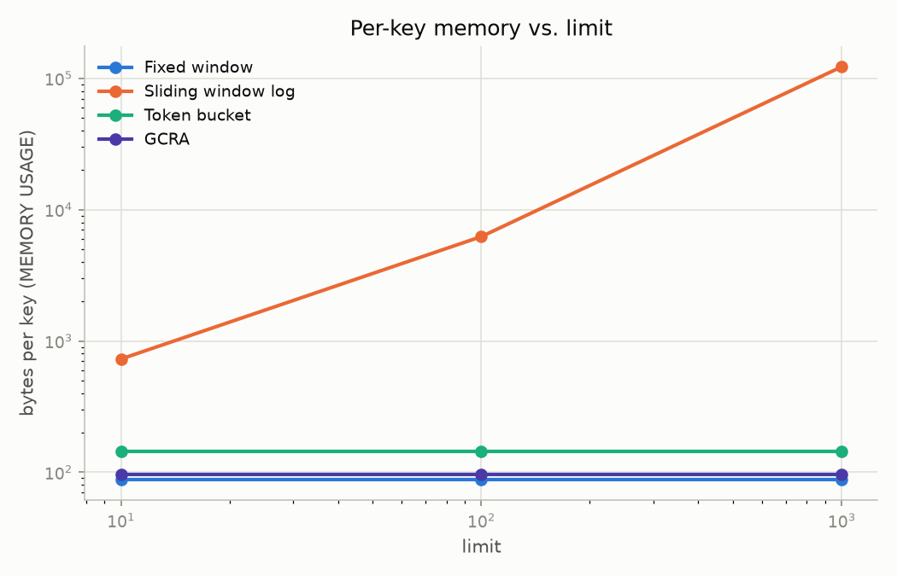
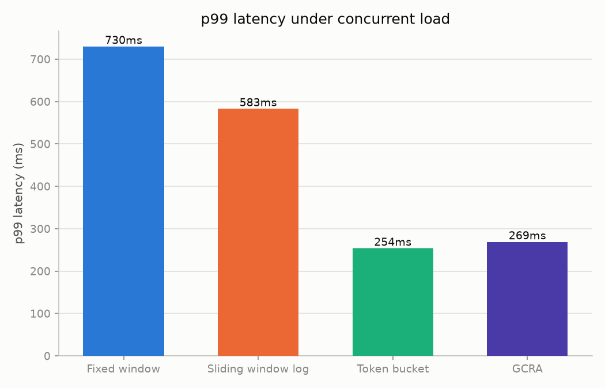
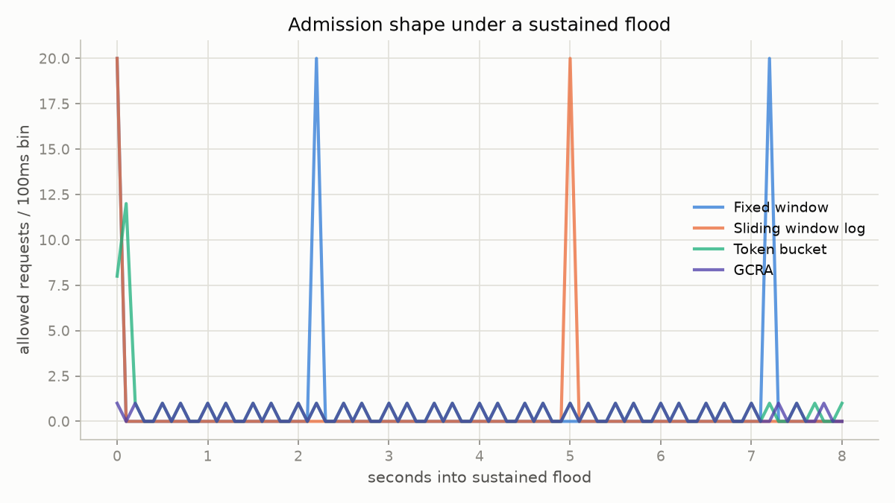

# Rate Limiter

A standalone rate-limiting service backed by Redis, implementing four algorithms
behind one HTTP API, plus a benchmark harness that measures how they actually
differ. State lives in Redis rather than in each process, so the limit holds
globally across app instances instead of per-instance (proven in
[Multi-instance verification](#multi-instance-verification) below). Policy
configuration lives in PostgreSQL instead, since durable config and ephemeral
hot-path counters have different needs — see
[Data stores](#data-stores-polyglot-persistence-not-one-database-for-everything).

## The bug this project exists to fix

Every one of these algorithms is fundamentally a read-modify-write against
Redis. The first version built here ([`fixed_window_naive.py`](app/algorithms/fixed_window_naive.py))
does it the way most people write it first: `GET` the current count, decide
whether the caller is under the limit, then `INCR`. That's a classic
check-then-act race.

[`tests/test_fixed_window_naive.py`](tests/test_fixed_window_naive.py) fires
`limit x 10` concurrent requests at a single key with a limit of 10 and asserts
exactly 10 get through. On this machine it doesn't — **all 100 concurrent
requests were admitted**, 90 over the configured limit
(captured in `tests/artifacts/naive_race_result.json` when the test runs; the
exact number varies run to run depending on scheduling, but it is always
dramatically over the limit, since all 100 `GET`s tend to land before any
`INCR` does).

The fix ([`app/algorithms/fixed_window.py`](app/algorithms/fixed_window.py),
[`lua/fixed_window.lua`](lua/fixed_window.lua)) moves the whole
read-modify-write into a Lua script executed via `EVALSHA`, so it runs
atomically inside Redis. Re-running the same concurrency test against the
Lua version passes exactly — see
[`tests/test_fixed_window_lua.py`](tests/test_fixed_window_lua.py).

That sequence — naive version, failing test, captured number, atomic fix,
passing test — is preserved as four separate commits in this repo's history
(`git log --oneline`), each one buildable and testable on its own.

### A second, different bug: the boundary flaw

Fixing atomicity does **not** fix everything. `tests/test_boundary.py` sends a
full quota of requests just before a window edge and again just after. This is
an *algorithm-design* flaw, not a concurrency bug, and it survives the Lua fix:

| | Concurrency race (single key, flood) | Boundary flaw (window edge) |
|---|---|---|
| Naive fixed-window | Over-admits (measured: 100/100 vs. limit 10) | Over-admits (measured: 10/10 vs. limit 5 — exactly 2x) |
| **Lua fixed-window** | **Fixed** (passes exactly) | **Still over-admits** (same 10/10 vs. 5) |
| Sliding window log | Fixed | Fixed |

The atomicity fix closes the race. It does nothing for the boundary flaw,
because fixed-window only ever looks at "how many requests landed in *this*
window" — a client can always send a full quota at `T-1s` and another full
quota at `T+1s` and both windows will honor it. Only a different algorithm
(sliding window log) actually fixes that. `benchmark/accuracy.py` reproduces
this same boundary test over HTTP against a running server and is the source
of the 10/10-vs-5 number above.

## Four algorithms

| Algorithm | Boundary-accurate | Memory per key | Notes |
|---|---|---|---|
| Fixed window | No (2x at edges) | O(1), flat (~88 B) | Simplest; kept mainly as the naive-vs-atomic teaching example above |
| Sliding window log | Yes, exact | **O(limit)** — 728 B @ 10 → 122,624 B @ 1000 | Perfectly accurate, at a real memory cost that scales with the limit |
| Token bucket | Yes | O(1), flat (~144 B) | Allows controlled bursting; refills lazily, no background job |
| GCRA | Yes | O(1), flat (~96 B) | Single stored number; smooth pacing; exact `Retry-After` for free |

Measured with `benchmark/memory.py` (`MEMORY USAGE` per key at limits of 10,
100, 1000) — see the memory growth plot in [Benchmarks](#benchmarks) below.

**When to choose each:**

- **Fixed window** — don't, for anything that matters. It's here to demonstrate
  the concurrency and boundary flaws above; a real fixed-window limiter this
  simple will always be exploitable at window edges.
- **Sliding window log** — when you need exact accuracy and your limits are
  small enough that O(limit) memory per key is cheap (e.g. a handful of
  requests per minute per user). Gets expensive fast at high limits.
- **Token bucket** — when you *want* to allow bursts (a user idle for a while
  should be able to spend their built-up allowance quickly) but still enforce
  a steady long-run rate. The intuitive, commonly-reached-for choice.
- **GCRA** — when you want smooth, evenly-paced admission with no burst
  latitude, O(1) memory regardless of limit, and an exact `Retry-After` without
  extra computation. The algorithm to reach for if you don't specifically need
  token bucket's burst behavior.

GCRA note: this implementation uses `burst_tolerance = emission_interval *
(burst - 1)`, not `emission_interval * burst`. The latter (the formula you'll
see in most casual explanations of GCRA) admits `burst + 1` requests in an
instant flood rather than exactly `burst` — verified empirically here (6
admitted against a limit of 5) before switching to the `(burst - 1)` form that
production implementations (Stripe, Cloudflare, the `throttled` library) use.

## Data stores: polyglot persistence, not one database for everything

Two stores, each used for what it's actually good at — not a stack change,
a deliberate split:

- **Redis** — every hot-path rate-limit counter (all four algorithms), plus
  the idempotency-key dedup cache (inherently time-bounded, 24h TTL — exactly
  Redis's sweet spot). Configured with `--save ""`: zero durability, by
  design, since losing this state just means limits reset.
- **PostgreSQL** — the named policy registry (`app/db.py`, `app/policies.py`).
  Policies are config, written rarely and expected to survive a restart,
  which Redis with `--save ""` cannot provide. Moving them to Postgres closes
  a real gap: previously, a Redis restart silently wiped every registered
  policy along with the ephemeral counters. Verified directly — register a
  policy, restart only the `redis` container, `GET` the policy again: it's
  still there, because it was never in Redis to begin with.

`POST /check` still only touches Redis (one `EVALSHA`, or two calls if a
named `policy` is used — the extra one resolves it from Postgres). The
hot path never waits on a relational round trip for the actual rate-limit
decision, only for policy *resolution*, which is a cheap indexed lookup on a
primary key.

## Rejection events (Redis Streams)

Every `429` appends one entry to a capped Redis Stream (`app/events.py`,
`rl:events:rejections`, `MAXLEN ~ 10000`) — `algorithm` and `key`, with the
entry ID left for Redis to assign from its own clock (same "never trust an
app-side clock" principle as every Lua script's `TIME` call). This is *not*
atomic with the rate-limit decision itself: losing an occasional event on a
crash is an acceptable trade-off for an observability signal, unlike the
rate-limit state, which must be exact.

`GET /events/rejections?limit=50` reads it back (most recent first), for
inspection — but there's also a real consumer now, `app/consumer.py`, run as
its own `alerter` docker-compose service, never inside the app containers
(alerting must never sit on the `/check` hot path). It uses `XREADGROUP`
with a consumer group (crash-resumable — unacked entries redeliver, unlike
plain `XREAD`), tracks rejections per key in a sliding window
(`ALERT_THRESHOLD` in `ALERT_WINDOW_SECONDS`), and fires a webhook once a
key crosses it, then goes quiet on that key for `ALERT_COOLDOWN_SECONDS` to
avoid alert storms. Set `ALERT_WEBHOOK_URL` to a real Slack incoming-webhook
URL to actually post there; unset, it logs the alert instead — fully
demoable without any external account. Verified end-to-end against the
running stack: flooding a `limit=1` key produced a 429 on every request past
the first, and the alerter logged exactly one alert at the 5th rejection,
correctly suppressing the 6th and 7th via cooldown.

## gRPC: Envoy-compatible rate limit service

Alongside the REST API, `app/grpc_server.py` implements Envoy's actual
[external rate limit protocol](https://github.com/envoyproxy/envoy/blob/main/api/envoy/service/ratelimit/v3/rls.proto)
(`RateLimitService.ShouldRateLimit`) on port `50051`, running in the same
process and sharing the same Redis/Postgres connections as the REST API.

`proto/rls.proto` is a **wire-compatible subset** of the official proto —
same package, service name, RPC name, message names, and field numbers for
everything implemented — not the full vendored file. The official version
also imports `protoc-gen-validate` and `udpa` versioning annotations, which
are Envoy-internal tooling metadata, not required for the wire protocol
itself; pulling those in would mean vendoring ~10 transitive `.proto` files
for no behavioral benefit here. A real Envoy proxy configured with this as
its rate limit service target can talk to it, since protobuf wire
compatibility depends only on field numbers/types.

`domain` resolves against the same named-policy registry `POST /check` uses
with `{"policy": ...}`; each descriptor's `entries` become the per-identity
key, sorted so entry order in the request can't change identity. Multiple
descriptors in one request are checked individually — `OVER_LIMIT` overall
if *any* one is over, matching Envoy's real semantics.

Regenerate the stubs after editing `proto/rls.proto`:

```bash
uv run python -m grpc_tools.protoc --proto_path=. --python_out=. --grpc_python_out=. --pyi_out=. proto/rls.proto
```

Not implemented (present in the real proto, out of scope here):
`RateLimitOverride`, `Quota`, header/metadata passthrough,
`DescriptorStatus.current_limit`. `hits_addend` (variable request cost) is
accepted for protocol completeness but not yet wired to variable-cost
consumption — every algorithm still consumes exactly 1 unit per check.

## API

### `POST /check`

Consumes one unit of quota for `key`. **Deliberately not idempotent** —
consuming quota is the entire point, so replaying the exact same request must
count again.

```jsonc
// either a named policy...
{"key": "user-123", "policy": "api-default"}
// ...or inline config (mutually exclusive with `policy`)
{"key": "user-123", "algorithm": "gcra", "limit": 100, "window": 60, "burst": 20}
```

Returns `200` (allowed) or `429` (rejected), with `X-RateLimit-Limit`,
`X-RateLimit-Remaining`, `X-RateLimit-Reset` always set and `Retry-After` set
on `429` — mirrored in the JSON body too:

```json
{"allowed": true, "limit": 100, "remaining": 99, "reset": 1786532313, "retry_after": 0, "algorithm": "gcra", "key": "user-123"}
```

### `POST /policies` / `GET /policies/{name}` / `GET /policies/{name}/history`

Register a reusable named rate-limit config so callers don't have to repeat
algorithm/limit/window on every `/check` call. `POST /policies` **requires**
an `Idempotency-Key` header: replaying the same key with the same body returns
the cached response, replaying it with a different body 409s. This is the
inverse of `/check` on purpose — policy registration is a config write you'd
want safe to retry, quota consumption is not.

Every create/update writes one row to `policy_audit_log` — same transaction
as the write itself, so the audit trail can't silently fall out of sync with
`policies`. `GET /policies/{name}/history` reads it back, most recent first,
recording which fields changed, the `Idempotency-Key` of the request that
made the change (the closest thing to a "who" this project has, since there's
no auth layer yet), and when. An idempotent replay of an unchanged request
correctly does **not** append a new history entry, since nothing was written
— the cached-response path short-circuits before `create_policy` ever runs.

### `GET /events/rejections`

Reads recent rejection events from the Redis Stream described above — most
recent first, `?limit=` capped at 500.

### `GET /healthz`

Pings both Redis and Postgres; used by the docker-compose healthcheck.

## Benchmarks

Run with a live server: `uv run python -m benchmark.run_all`. Four
measurements, each independently runnable (`benchmark/accuracy.py`,
`memory.py`, `throughput.py`, `burst_shape.py`).

**Memory vs. limit** — sliding-window-log's O(limit) growth against the flat
O(1) cost of the other three:



**p99 latency under concurrent load:**



**Admission shape under a sustained flood** — fixed-window sawtooths at each
window reset, token-bucket (given its default burst, equal to the limit)
spikes once then settles to the steady refill rate, GCRA (deliberately
configured here with a tight `burst=1`, its actual differentiator) paces
evenly with no head start at all, sliding-window-log stays smooth near the
limit:



These numbers are from a single run on one (unremarkable, shared, sandboxed)
dev machine with a single uvicorn worker and no production tuning — treat the
*relative* ordering and shapes as the signal, not the absolute millisecond
values, which will vary by hardware and load.

## Multi-instance verification

`docker-compose.yml` runs three separate app instances (`app1`/`app2`/`app3`,
ports 8001-8003) behind one shared Redis and one shared Postgres — no load
balancer, just distinct ports, since the whole point is proving state is
shared, not routing.

```
docker compose up --build -d
uv run python scripts/verify_multi_instance.py
```

Round-robins 30 requests (limit=10) across all three instances against the
same key. Measured result:

```
Per-instance breakdown:
  http://localhost:8001: 4 allowed
  http://localhost:8002: 3 allowed
  http://localhost:8003: 3 allowed
Total allowed across all instances: 10 (limit=10)
PASS: limit held globally across 3 instances, not per-instance
```

10 total, not 30 — the limit holds across the fleet because the state lives
in Redis, not in any one process's memory.

### Kubernetes

`k8s/` has the same 3-instance topology expressed the idiomatic K8s way —
`redis.yaml`, `postgres.yaml`, `secret.yaml`, `app.yaml` (a 3-replica
Deployment + Service). Demo-grade manifests: single-replica Redis/Postgres
with no PVC (no durability of their own — a real cluster would use managed
services or a StatefulSet+PVC). Before applying, replace `CHANGE_ME` in
`k8s/secret.yaml` with a strong password, or source the Secret from a secrets
manager. Build and load the image before applying:

```bash
docker build -t rateguard-app:latest .
kind load docker-image rateguard-app:latest   # or your cluster's equivalent
kubectl apply -f k8s/
```

These manifests are YAML-syntax-validated (`python -c "import yaml; ..."`)
but **not** dry-run-validated against a real API server — no `kubectl`/`kind`
available in the environment this was built in. Validate with
`kubectl apply --dry-run=client -f k8s/` (or `kubeconform`) before relying on
them against a real cluster.

## Horizontal sharding (consistent hashing across Redis nodes)

Everything above assumes one Redis holding every counter — a single point
of failure and a throughput ceiling, since every algorithm on every
instance funnels through it. `app/sharding.py` + `app/shard_router.py` add
optional
horizontal sharding: rate-limit counters distribute across N independent
Redis nodes via a consistent-hash ring, instead of one node holding
everything. **Off by default** — `REDIS_SHARD_URLS` unset means zero
behavior change from everything documented above; every existing test,
docker-compose service, and code path is unaffected. Only the hot-path
counters shard; the policy registry, idempotency cache, and rejection-event
stream stay on the single default Redis regardless, since they're
low-volume metadata, not the part that scales with key cardinality.

**Why consistent hashing over `hash(key) % N`:** the same key must always
route to the same node (a rate-limited identity's counter splitting across
nodes silently breaks the limit), and adding a node should remap a small
fraction of keys, not most of them. Measured directly
(`tests/test_sharding.py`): growing a 3-node ring to 4 remapped **25.1%**
of 10,000 keys with consistent hashing — within a rounding error of the
theoretical ideal of 1/4 — versus **75.2%** with naive modulo hashing on
the exact same key set.

`docker-compose.yml`'s `app-sharded` service (port 8005) demonstrates it
against three genuinely separate Redis containers (`redis-shard-0/1/2`),
not just DB indices — `scripts/verify_sharding.py` sends 300 distinct keys
through it and confirms real distribution across all three nodes (measured:
99/95/106) and that routing is fully deterministic (the same 300 keys sent
twice landed on identical shards both times). `app1`/`app2`/`app3` are
completely unaffected and keep using the single default Redis — both
proofs (`verify_multi_instance.py` and `verify_sharding.py`) pass
simultaneously against the same running stack.

## Implementation notes

- **Time comes from Redis, not the app.** Every Lua script calls `TIME`
  internally rather than trusting a client-supplied timestamp — multiple app
  instances have skewed clocks, and a rate limiter that trusts client time is
  trivially defeated.
- **Every key has a TTL**, set inside the Lua script, so idle keys don't
  accumulate in Redis forever.
- **Scripts are loaded eagerly at startup** (`app/scripts_loader.py`, via
  `redis-py`'s `Script` wrapper, which handles `EVALSHA` with an automatic
  `NOSCRIPT -> EVAL` fallback) so a broken script fails at boot, not mid-traffic.

## Running it

```bash
uv sync --all-groups
docker compose up -d redis postgres

uv run uvicorn app.main:app --reload   # REST http://localhost:8000, gRPC :50051
uv run pytest -v                       # full test suite (needs redis + postgres up)
uv run python -m benchmark.run_all     # benchmark harness (server must be running)

# rejection-event alerter (own process, separate from the app)
uv run python -m app.consumer          # ALERT_WEBHOOK_URL unset -> logs instead of posting

# multi-instance proof (redis + postgres + 3 app instances + alerter + sharding demo)
docker compose up --build -d
uv run python scripts/verify_multi_instance.py   # single shared Redis, app1/2/3
uv run python scripts/verify_sharding.py         # 3 separate Redis nodes, app-sharded
docker compose down
```

## Project layout

```
app/
  algorithms/       four algorithm implementations + the naive fixed-window
  routers/          /check, /policies, /events, /healthz
  db.py             Postgres pool + schema (policy registry, audit log)
  events.py         Redis Streams rejection-event log
  consumer.py       standalone alerter: XREADGROUP + threshold + webhook/log
  grpc_server.py    Envoy-compatible RateLimitService (gRPC, port 50051)
  sharding.py       consistent-hash ring (pure, no I/O)
  shard_router.py   optional multi-Redis routing built on the ring
  scripts_loader.py Lua script registration (EVALSHA + NOSCRIPT fallback)
  schemas.py        request/response models
lua/                the four Redis Lua scripts
proto/rls.proto     wire-compatible subset of Envoy's rate limit protocol
db/init.sql         creates the rateguard_test database (docker-compose only)
k8s/                Kubernetes manifests: redis, postgres, secret, 3-replica app
tests/              pytest suite, incl. the concurrency/boundary tests above
benchmark/          asyncio benchmark harness (accuracy, memory, throughput, burst-shape)
scripts/            multi-instance and sharding verification
docker-compose.yml  redis + postgres + 3 app instances (REST + gRPC) + alerter + 3-node shard demo
```
